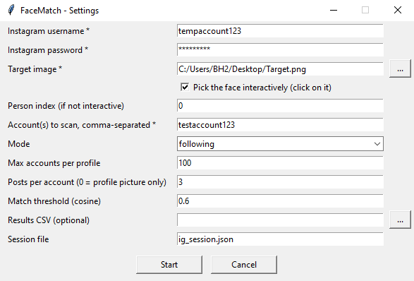
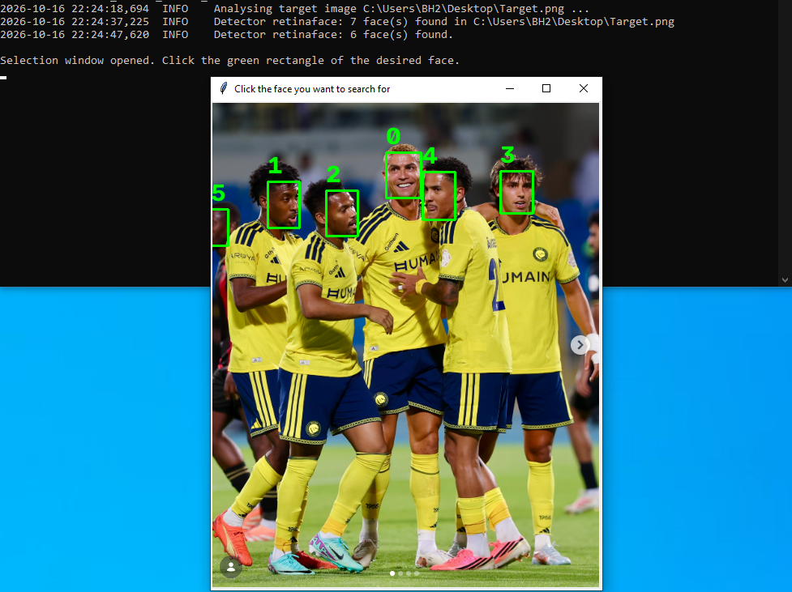
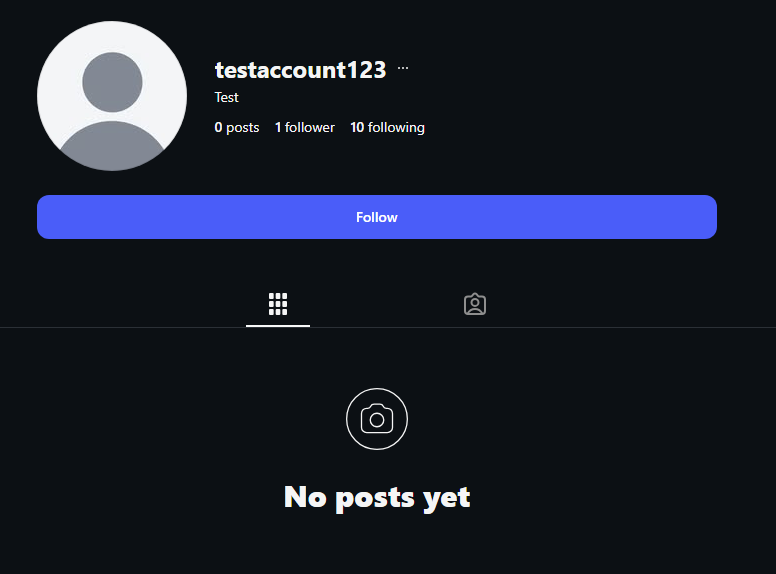
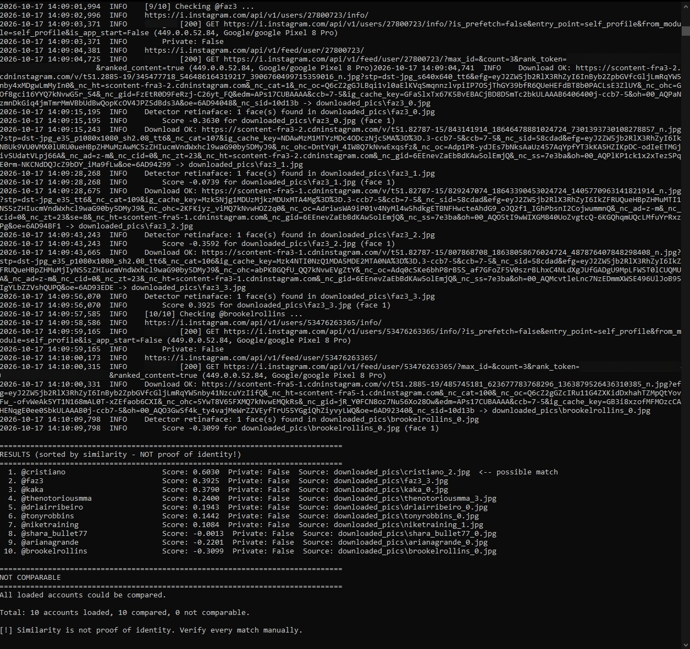

# FaceMatch

> Experimental computer vision project for face detection, visual similarity scoring, and automated image analysis. Developed as a software engineering portfolio project exploring AI-assisted image processing and candidate matching.

FaceMatch takes a photo of a person, lets you pick the face you are interested in, and ranks the followers or following of one or more Instagram profiles by how visually similar their profile picture – and optionally their recent posts – is to that face.

**Similarity scores are not proof of identity.** This tool compares face embeddings; it does not and cannot establish that two images show the same person. See [Privacy and responsible use](#privacy-and-responsible-use).

## Features

- Face detection with three detector backends tried in order: `retinaface` → `mtcnn` → `opencv`
- 512-dimensional face embeddings via DeepFace (`Facenet512`) and cosine similarity
- Interactive face picker: the target image is shown with numbered boxes, you click the face you want
- Settings window on startup – no command-line arguments required (CLI still fully supported)
- Instagram follower/following retrieval through `instagrapi`, with session persistence
- Full-size profile pictures instead of the 150 × 150 px thumbnails returned in follower lists (one extra request per account; falls back to the thumbnail if that request fails)
- Optional inspection of the last *N* posts per account in addition to the profile picture (photos and the first photo of each carousel)
- Retry pass: accounts whose image downloads failed permanently are processed a second time at the end of the run
- "Not comparable" report that lists every account that could not be compared, with a classified reason and a per-reason summary
- CSV export of both the ranking and the not-comparable list

## Showcase

**1. Settings window** – all parameters in one form, no command line needed



**2. Target image and face selection** – every detected face gets a numbered box; click the one you want to search for




**3. Scanned profile** – a dedicated test account that follows 10 verified public accounts; in `following` mode, exactly these accounts are compared with the selected face



<p>
  
  
</p>

**4. Results** – accounts ranked by similarity; scores at or above the threshold are marked as possible match



## Quick start

**You need:** Python 3.12 or 3.13 installed on your computer. Python 3.14 or newer is not supported, see [Requirements](#requirements).

1. **Download the project**
   Click the green **Code** button on this page → **Download ZIP**, then unzip it.
   Or with Git:
   ```bash
   git clone https://github.com/Eight7Six/insta-facematch.git
   cd insta-facematch
   ```

2. **Install the requirements**
   Open a terminal in the project folder and run:
   ```bash
   # Windows
   py -3.13 -m venv .venv        # or: py -3.12 -m venv .venv
   .venv\Scripts\activate

   # Linux / macOS
   python3.13 -m venv .venv      # or: python3.12 -m venv .venv
   source .venv/bin/activate

   pip install -r requirements.txt
   ```
   The version number in the first command matters: a plain `python -m venv .venv` uses your default Python, which may be 3.14 and will then fail at the TensorFlow step.

3. **Start the program**
   ```bash
   python facematch.py
   ```
   A settings window opens. Fill in your details and click **Start**. If the target photo shows more than one person, tick **Pick the face interactively** first; a window then opens where you click the face you want to search for.

When you open a new terminal later, activate the virtual environment again before starting the program.

## How it works

### Classification of each account

`process_user()` evaluates every account and returns exactly one of three states:

| State | Meaning |
|---|---|
| `ok` | At least one face was compared. The account appears in the ranking. If the comparison was based on partial data (e.g. posts returned HTTP 400, or the profile picture could not be downloaded but a post could), a `note` is attached. |
| `download_failed` | At least one download failed after 3 attempts and nothing could be compared. The account is queued for the retry pass. |
| `not_comparable` | No comparison was possible. A reason is recorded. |

Reasons used in the not-comparable report:

- `No profile picture` – `profile_pic_url` was empty and no posts were requested or available
- `No face detected` – images were downloaded but no detector found a face
- `Download failed permanently` – still failing after the retry pass
- `Posts unavailable and no usable image` – post retrieval raised an error (typically an Instagram HTTP error) and no other image could be evaluated
- `Private account without detectable face` – account is private and neither the profile picture nor posts yielded a face
- `Other/unexpected error` – fallback; the exception text is stored in `detail`

Accounts that were compared never appear in the not-comparable list.

## Requirements

- **Python 3.12 or 3.13** (tested with 3.13.15 and 3.12.9 on Windows, see [Development environment](#development-environment))
  - **Python 3.14 or newer is not supported.** TensorFlow 2.21.0 (used by DeepFace) is not available for Python 3.14, so installing the requirements on 3.14 fails at the TensorFlow step.
  - Python 3.10 and 3.11 are supported by TensorFlow 2.21.0 but have not been tested with this project.
- An Instagram account used for logging in. A dedicated throwaway account is strongly recommended.
- Tkinter (bundled with the python.org installer on Windows; on Debian/Ubuntu install `python3-tk`)
- Dependencies listed in `requirements.txt`

## Installation notes

For the installation steps, see [Quick start](#quick-start).

Do **not** install `opencv-python` alongside `opencv-contrib-python-headless`. Both provide the `cv2` module and must not coexist in one environment. The headless build is sufficient because the GUI is rendered with Tkinter, not with OpenCV windows.

## Usage

### Settings window (default)

```bash
python facematch.py
```

If any of the required values (username, password, target image, account) is missing from the command line, a settings window opens and asks for everything. Values that were passed on the command line are prefilled.

### Command line only

```bash
python facematch.py --no-gui \
  --username my_login --password my_password \
  --target-image photo.jpg --select \
  --account some_profile,another_profile \
  --mode following --limit 500 --posts-per-user 3 \
  --threshold 0.55 --csv results.csv
```

With `--no-gui` the script exits with an error instead of opening the settings window when required arguments are missing.

A password passed with `--password` may end up in your shell history. The settings window avoids this.

### First run

The first run may take longer because DeepFace downloads its pretrained model weights (several hundred MB) into `~/.deepface/weights` and initializes the models. The weights are cached locally, so they do not normally need to be downloaded again on subsequent runs.

### Parameters

| Parameter | Default | Description |
|---|---|---|
| `--username` | – | Instagram login (required) |
| `--password` | – | Instagram password (required, never stored) |
| `--target-image` | – | Path to the image containing the person to search for (required) |
| `--select` | off | Open the face picker and click the face to use |
| `--person-index` | `0` | Index of the detected face to use when `--select` is not given, or as fallback if the picker is closed without a click |
| `--account` | – | One profile or a comma-separated list whose followers/following are scanned (required) |
| `--mode` | `followers` | `followers` or `following` |
| `--limit` | `100` | Maximum accounts to fetch per profile |
| `--posts-per-user` | `0` | Additionally fetch the last N posts of each account. Photos are evaluated as they are, carousels by their first photo; videos and reels are skipped (`0` = profile picture only) |
| `--threshold` | `0.55` | Cosine similarity at or above which an entry is marked `possible match` |
| `--csv` | – | Path of the results CSV. The not-comparable list is written next to it as `<name>_not_comparable.csv` |
| `--session-file` | `ig_session.json` | Where the Instagram session is persisted between runs |
| `--no-gui` | off | Never open the settings window |

### Parameter notes

- **Person index:** If the target photo shows several people, each detected face gets a number starting at `0`. `0` = first face, `1` = second face, and so on. The order is decided by the face detector (usually by detection confidence), **not** left-to-right or top-to-bottom. The numbers shown in the face picker are the same indices, so you can look a face up there once and reuse its number later. If you are unsure, use the interactive selection (`--select`, click on the face) instead.

- **Match threshold:** Every compared account gets a similarity score, usually between `0` and `1`. The higher the score, the more alike the two faces look to the program. The threshold decides from which score on an account is marked as "possible match":
  - **Lower value** (e.g. `0.45`): more accounts get marked, but more of them will be wrong.
  - **Higher value** (e.g. `0.70`): fewer accounts get marked, but real matches may be missed.
  - The default is `0.55`. It is deliberately below DeepFace's own verification threshold for Facenet512 (`0.70`) so that it works as a generous pre-filter for manual review.
  - The score is **not a percentage** and **not proof** that it is the same person. All accounts appear in the ranking anyway; the threshold only adds the marker (in the console and in the `possible_match` CSV column).

- **Session file:** Remembers your Instagram login, so you don't have to log in again on every run. It contains login data – never share it or upload it.
  - The saved session is checked at startup. If Instagram has expired it, the program logs in again automatically and saves the new session.
  - A session belongs to the account it was created with. To switch to another Instagram account, delete the file first.

### Face picker

When `--select` is used, a window shows the target image with a green, numbered box around every detected face. Click the face you want. Large images are downscaled to fit on screen; the click is mapped back to original coordinates. The boxes come from the same detection run that produces the face embeddings, so the target image is analysed only once and the numbers in the window match `--person-index`.

## Output

### Console

1. **RESULTS** – ranked by score, with username, score, private flag, source image (`<user>_0.jpg` = profile picture, `_1`… = posts) and an optional `Note:` line for partial data.
2. **NOT COMPARABLE** – one line per account with username, private flag, reason and detail, followed by a count per reason.
3. A totals line: accounts loaded / compared / not comparable.

### CSV

`results.csv`

| Column | Content |
|---|---|
| `rank` | Position in the ranking |
| `username`, `full_name` | As returned by Instagram |
| `is_private` | Private flag |
| `score` | Best cosine similarity across all evaluated images (4 decimals) |
| `possible_match` | `yes` if the score is at or above the threshold, otherwise empty |
| `source` | Name of the image that produced the best score (for reference only; the file itself is deleted after processing) |
| `note` | Empty, or a hint that the comparison used partial data |

`results_not_comparable.csv`

| Column | Content |
|---|---|
| `username`, `full_name`, `is_private` | As above |
| `reason` | One of the reasons listed under [Classification](#classification-of-each-account) |
| `detail` | Raw error text or additional context, may be empty |

Downloaded images are deleted right after they have been analysed, so `downloaded_pics/` only holds the image currently being processed.

## Performance

In my current setup, processing around 100 accounts with 3 posts per account (plus the profile picture) takes approximately 25 minutes. This was measured before full-size profile pictures were added; the extra request per account increases the runtime somewhat. Actual runtime varies with network conditions, Instagram responses, the number of posts checked per account, and any download retries.

## Known limitations

- **Similarity ≠ identity.** Embedding distance depends on pose, lighting, resolution, age, filters and the detector that happened to succeed. Expect false positives and false negatives.
- **Instagram's private API.** `instagrapi` talks to Instagram's undocumented mobile API. Instagram may throttle, challenge or block accounts that use it. HTTP 400/429 responses on post retrieval are common and are reported as partial data or `Posts unavailable`.
- **`is_private` reliability.** The flag is taken from the same request that fetches the full-size profile picture. If that request fails, the value from the follower list is used, which `instagrapi` does not always populate; it may then be `False`.
- **Private accounts.** Posts of private accounts you do not follow are not retrievable. Only the profile picture is evaluated.
- **No parallelism, no caching.** Accounts are processed sequentially with a fixed pause of 1.5 s between them. Large limits take correspondingly long.
- **No automated tests** are included in this repository.
- **Detector availability.** The `mtcnn` backend requires the optional `mtcnn` package. If it is missing, DeepFace raises an error for that backend and the script falls back to the next one.

## Privacy and responsible use

This project is a technical demonstration and portfolio piece. It is published to show an implementation of face detection, embedding-based similarity and robust batch processing – not to encourage identifying strangers online.

- The output is a ranking of **visual similarity**. It is not evidence that any account belongs to a particular person. Treat every "possible match" as an unverified hypothesis.
- Face embeddings derived from photos of identifiable people are **biometric data**. Under the GDPR and comparable laws, processing such data about third parties generally requires a legal basis and is subject to strict rules. Running this tool against real people without their consent may be unlawful in your jurisdiction. You are responsible for compliance.
- Automated collection of data from Instagram without permission is restricted by **Instagram's Terms of Use**. Use a test account that you own and are prepared to lose.
- Never commit target images, downloaded pictures, result CSVs, session files or credentials. The included `.gitignore` excludes them, but check `git status` before every push.
- Do not use this software for stalking, harassment, surveillance, or any purpose that harms the people depicted.

## Development environment

- Windows
- Python 3.13.15, project-local virtual environment (`.venv`)
- `python -m pip check` reports no broken requirements in this environment

A clean install from `requirements.txt` was verified on a second Windows machine with Python 3.12.9. Other operating systems have not been tested; version pins reflect the development environment.

## Tech stack

| Component | Library |
|---|---|
| Face detection and embeddings | `deepface` (Facenet512, RetinaFace, MTCNN, OpenCV backends) on TensorFlow / `tf-keras` |
| Image handling | `opencv-contrib-python-headless`, `Pillow`, `numpy` |
| GUI (settings window, face picker) | `tkinter` (standard library) |
| Instagram access | `instagrapi` |
| HTTP downloads | `requests` |
| CLI, logging, CSV | standard library |

## Development status

No further feature development is currently planned. This repository is maintained as a portfolio and demonstration project.

## License

MIT – see [LICENSE](LICENSE).
